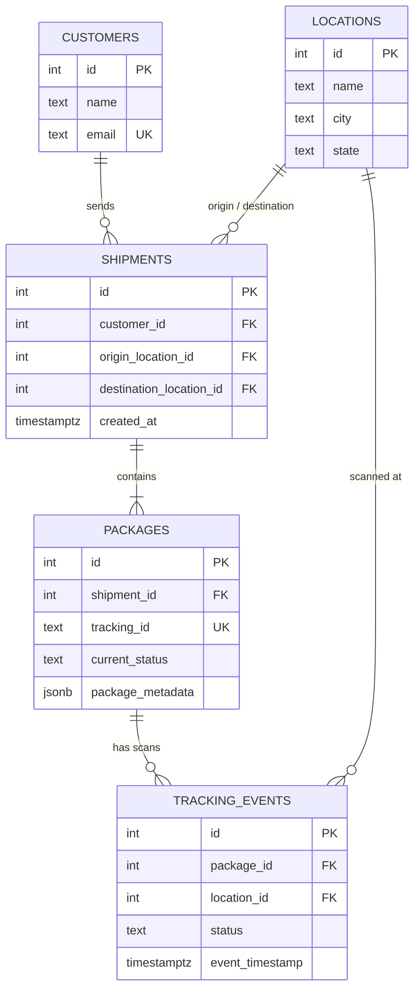

# Logistics and Shipment Tracking Backend

The data service of a shipment tracking company. It receives scan events from warehouses and drivers, updates package status **atomically**, and can rebuild the full history of any package.

| Store | Used for |
|---|---|
| **PostgreSQL** | Customers, locations, shipments, packages, tracking events; package metadata as `JSONB`; the history query |
| **Redis** | The latest status of each package, for fast reads |
| **MongoDB** | Raw scanner event logs, kept for auditing |

Python 3.11+ (developed on Python 3.14), `psycopg2` with a connection pool, `redis`, `pymongo`, Poetry, Docker Compose.

## Entity-relationship diagram



## Schema explanation and normalization

The schema (`sql/schema.sql`) is in **third normal form (3NF)**.

- **`customers` → `shipments` → `packages`.** A shipment belongs to one customer (the sender) and has an origin and a destination. Packages hang off a shipment, so customer and route data are stored **once**, not repeated on every package.
- **`locations` is its own table.** A hub's name, city and state are stored once and referenced by id from shipments and scans. A scan can only happen at a location that exists (foreign key).
- **`tracking_events` is its own table.** A package has many scans over time. Each scan is one row, so the history is never overwritten.
- **`tracking_id` is a column of `packages`** (`UNIQUE`). It is the public code a customer types in (for example `PKG-1001`) and the key used in Redis. It is not the same as `packages.id`, which is the internal key used by foreign keys.
- **Constraints:** `NOT NULL` on required columns; `UNIQUE` on `customers.email`, `packages.tracking_id` and `locations (name, city, state)`; a `CHECK` that a shipment's origin differs from its destination; a `CHECK` limiting statuses to `Created`, `Picked Up`, `In Transit`, `Out for Delivery`, `Delivered`, `Exception`; all relationships are foreign keys.
- **`TIMESTAMPTZ`** for all times, because scans happen in different time zones.
- **`package_metadata` is `JSONB`** for package attributes that vary (`fragile`, `requires_signature`, ...).

### A deliberate exception: `packages.current_status`
`current_status` repeats information that is also in the latest `tracking_events` row. This is a **deliberate denormalization**: reading the current status is one row lookup and does not scan the history. The price is that the two must never disagree, so they are always written **in the same transaction** (see below).

## Project structure

```
.
├── docker-compose.yml
├── pyproject.toml / poetry.lock
├── requirements.txt
├── sql/
│   ├── schema.sql          # DDL
│   ├── sample_data.sql     # sample rows
│   ├── indexes.sql         # composite index (loaded after measuring)
│   └── benchmark.sql       # 200,000-row before/after measurement
├── src/logistic_and_shipment_tracking_backend/
│   ├── db.py               # connection pool
│   ├── tracking.py         # process_tracking_scan, get_package_history
│   ├── cache.py            # Redis latest status
│   ├── scan_log.py         # MongoDB raw scan logs
│   └── service.py          # handle_scan: the whole pipeline
└── tests/
    ├── conftest.py
    ├── test_tracking.py
    └── test_nosql.py
```

## How to run

You need Docker Desktop and Poetry.

```bash
# 1. Start the databases
docker compose up -d
docker compose ps            # wait until logi_postgres is "healthy"

# 2. Load the schema and sample data (once)
docker cp sql/schema.sql logi_postgres:/schema.sql
docker cp sql/sample_data.sql logi_postgres:/sample_data.sql
docker exec -it logi_postgres psql -U app -d logistics -f /schema.sql
docker exec -it logi_postgres psql -U app -d logistics -f /sample_data.sql

# 3. Install and test
poetry install
poetry run pytest -v
```

**Ports** (published on the host so they do not clash with other projects): PostgreSQL **5434**, Redis **6380**, MongoDB **27018**. The code uses these as defaults. They can be overridden with `PGHOST`, `PGPORT`, `PGUSER`, `PGPASSWORD`, `PGDATABASE`, `REDIS_HOST`, `REDIS_PORT` and `MONGO_URI`.

To start again from scratch: `docker compose down -v`, then repeat steps 1 and 2 **once** (loading the sample data twice fails on the unique email).

### Processing a scan

```python
from logistic_and_shipment_tracking_backend.service import handle_scan
from logistic_and_shipment_tracking_backend.tracking import get_package_history

print(handle_scan("scanner-9", 2, 2, "In Transit"))   # -> PKG-1002
for row in get_package_history(2):
    print(row)
```

Example output (status, city, time, time since the previous scan):

```
('Created',   'Kigali', 2026-10-30 08:05+00, None)
('Picked Up', 'Kigali', 2026-10-30 09:20+00, 1:15:00)
```

## How a scan is processed

`handle_scan` (in `service.py`) does three steps **in this order**:

1. **MongoDB first.** The raw scan (scanner id, package, location, status, time) is stored exactly as received. The audit log must keep even scans that fail later.
2. **PostgreSQL transaction.** `process_tracking_scan` inserts the row into `tracking_events` and updates `packages.current_status` in **one ACID transaction** (`with conn:`). If either step fails, neither is saved. It uses `UPDATE ... RETURNING tracking_id` to get the tracking id in the same statement, and raises `ValueError` for an unknown package. All queries are **parameterized** (`%s` placeholders), so input is never pasted into SQL.
3. **Redis last.** Only after the commit, the key `package:<tracking_id>:status` is set to `{"status": "In Transit", "location": "Nairobi, KE"}`. Doing this last means the cache can never show a status that PostgreSQL rolled back.

The Redis value has no expiry: PostgreSQL stays the source of truth, and the next scan overwrites the key.

## The history query

`get_package_history` rebuilds the full history of a package with a **CTE** and `LAG()`:

```sql
WITH history AS (
    SELECT te.status, l.city, te.event_timestamp
    FROM tracking_events te
    JOIN locations l ON l.id = te.location_id
    WHERE te.package_id = %s
)
SELECT status, city, event_timestamp,
       event_timestamp - LAG(event_timestamp) OVER (ORDER BY event_timestamp)
         AS since_previous
FROM history
ORDER BY event_timestamp;
```

The CTE selects one package's scans and attaches each city. `LAG(event_timestamp)` looks at the previous row in time order, so the difference is the time between two scans. The first scan has no previous row, so its gap is `NULL` (`None` in Python).

## Performance report (`EXPLAIN ANALYZE`)

The history lookup filters on `package_id` and sorts by time. The composite index is:

```sql
CREATE INDEX idx_tracking_events_package_time
    ON tracking_events (package_id, event_timestamp);
```

**Why this column order?** The query first picks the rows of one package (`package_id = ...`), then needs them in time order. With `package_id` first, the index groups each package's scans together and keeps them sorted by time inside the group, so Postgres jumps straight to the package's rows. With the columns reversed, the rows of one package would be scattered through the index.

**How it was measured:** `sql/benchmark.sql` loads 2,000 packages with 100 scans each (200,000 events), runs `EXPLAIN ANALYZE` on `SELECT * FROM tracking_events WHERE package_id = <id> ORDER BY event_timestamp`, creates the index, and runs it again. It runs inside a transaction that is **rolled back**, so the real data is untouched.


## Testing

`tests/` runs against the real containers (7 tests):
- a scan saves the event **and** updates `current_status`;
- a scan with an invalid status saves nothing (no event, status unchanged);
- a scan of an unknown package saves nothing;
- the history query returns the right order and the right gaps (`None`, 2 h, 30 min);
- Redis stores and returns the latest status;
- MongoDB keeps the raw scan;
- `handle_scan` updates PostgreSQL, Redis and MongoDB together.

## Known limitations
- The list of valid statuses is repeated in two `CHECK` constraints (`packages` and `tracking_events`). A separate `statuses` table would remove the repetition at the cost of an extra table and joins.
- The rollback tests accept either a `ValueError` or a database error, so they check that nothing was saved, not which error was raised.
- If the program crashes between the PostgreSQL commit and the Redis update, the cache is stale until the next scan of that package. PostgreSQL still has the correct status.
- `get_package_history` is not paginated; a package with very many scans returns them all.